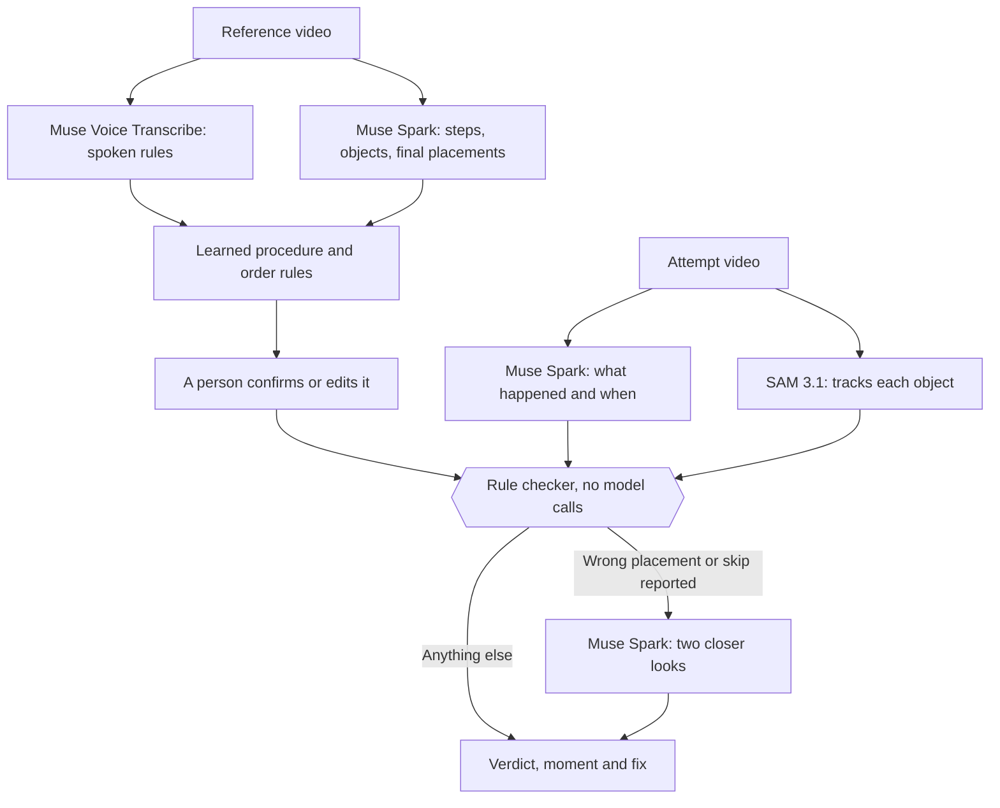

# OneShot

**Show it once. Check every attempt.**

Two people can pack the same box and end with the same final picture, but only one followed the procedure. OneShot learns a tabletop procedure from one recorded demonstration, then checks recordings of later attempts and reports what went wrong, when it happened and how to fix it.

**[Watch the 3-minute demo](https://youtu.be/w91nOT9J0PM)** · **[Open the live app](https://tanjilsarwar30--oneshot-web-web.us-east.modal.run)** · **[Take the guided walkthrough](https://tanjilsarwar30--oneshot-web-web.us-east.modal.run/judge)** · [Judge notes](JUDGING.md)

Everything here was built during the event, Oct 26 to Nov 4, 2026, except the material listed under [Pre-existing and third-party material](#pre-existing-and-third-party-material).

## Try it in two minutes

1. **Change a rule.** In the [walkthrough](https://tanjilsarwar30--oneshot-web-web.us-east.modal.run/judge), go to step 2 and make "liner before accessory" free. The verdict changes from a failure to a pass with a note, with no new model call.
2. **Run a real check.** In the [live app](https://tanjilsarwar30--oneshot-web-web.us-east.modal.run), keep a sample reference, download a sample attempt from the page and upload it. This calls Meta's models and took about 40 to 50 seconds in the latest checks.

The site can take a few seconds to wake up. Uploads stop if the public spend cap is reached, but the saved samples keep working.

## What makes it different

You don't write a procedure document. OneShot works out which step orders matter from the demonstration:

| Order rule | Where it comes from | If an attempt breaks it |
|---|---|---|
| **Required** | Said out loud in the reference, or physically necessary (the product sits on the liner) | Fail |
| **As shown** | Only seen in this order, and nothing says it matters | A note, never a failure |
| **Free** | Someone said so, or a second correct reference did it the other way | Nothing |

A person confirms or changes any rule, and every attempt is re-checked immediately without another model call.

## How it works



Each check ends in one of four verdicts: **pass**, **pass with notes**, **can't verify** or **fail**. How much tracking supports that verdict is reported separately as corroborated, partial, inconclusive or model only. If tracking is missing or disagrees with the video reading, the result goes to review. A pass with partial evidence means tracking didn't confirm every placement, so the result isn't marked as verified.

### Meta models

| Model | Access | What it does |
|---|---|---|
| Muse Spark 1.3 | Hosted API | Reads steps, objects and final placements from video, ties spoken lines to steps, and answers the closer-look questions |
| Muse Voice Transcribe 1.0 | Hosted API | Produces the timed transcript of a narrated reference |
| SAM 3.1 | Hosted API | Tracks each object, giving evidence separate from the video reading |
| Muse Spark Open (open weights) | Baseten (whole clip) or Fireworks (keyframes) | Replaces hosted Muse Spark as the extractor with `--provider baseten` or `--provider fireworks`. This path is command-line only: the live site uses hosted Muse Spark. Tracking stays on hosted SAM 3.1 |

## What has been measured

This is all development evidence. The real footage is the builder's own and informed the fixes, so none of these results is a held-out accuracy benchmark.

| Test | Result |
|---|---:|
| 9 real two-block attempts on a phone | 6 resolved, 3 sent to review; 0 of 6 mistakes accepted, 0 of 3 acceptable or occluded attempts rejected |
| 5 real packing attempts, one fresh run each on one build | All 5 verdicts matched the recording; evidence was partial on 4 and inconclusive on 1 |
| 24 generated packing attempts, saved model outputs | 24 of 24 with Muse Spark 1.3, and 24 of 24 with Muse Spark Open on the same clips |
| 16 generated variations | 16 of 16 on replay, including 2 sent to review; the first fresh run was 14 of 16, with 2 tracking timeouts |
| 3 generated order-only mistakes | A final-picture check accepted 3; OneShot accepted 0 |
| 13 reported problems double-checked with closer looks | 11 of 12 true problems confirmed; the 1 false problem went to review |
| 2 real uploads to the live site, Nov 4 | Correct clip passed in 38 s, wrong placement failed in 46 s, both with partial evidence ([report](docs/evidence/live_uploads_2026-11-04.json)) |
| Offline test suite, model services mocked | 221 of 221 pass on Windows with Python 3.14 and in the [Linux deployment image](docs/evidence/release-linux-validation.json) with Python 3.12 |
| Judge interaction tests, delayed responses and network failures | 5 of 5 pass (`node --test tests/judge_state.test.cjs`) |

**What these results don't show:**

- **Results can vary between runs.** One packing clip with a missing charger (P03) failed correctly in the run above, but a later fresh run returned "can't verify" because the tracker confused the card and the charger. After a fix, a tracker-only rerun kept the two apart, but that clip has not had a full fresh run on the current build ([rerun report](docs/evidence/packing_rerun_2026-11-03.json)).
- **Phone footage has not shown the order advantage.** The two-block recordings contain no order-only mistake, and the final-picture check did just as well on them. The one real order-only clip (P02) also had a misreading and a tracking timeout, so it doesn't settle this.
- **Tracking has added caution, not corrections.** Across 36 saved tracked readings, tracking changed five verdicts, all to review.
- **The independent trial hasn't happened.** 0 of its 9 cases have been recorded, no second person has tested OneShot, and no workplace benefit has been measured. The trial is ready at `/pilot`, with labels and the procedure frozen before inference.

Full reports are in [`web/static/media/`](web/static/media/), and the history behind each number is in the [changelog](CHANGELOG.md).

## Limits

- **Tabletop placements only.** OneShot checks objects placed on, inside or near other objects. A procedure with no placements gives it nothing to check.
- **Tracking is 2D.** Boxes support visibility and approximate position. They don't prove physical contact or safety.
- **Video reading is probabilistic.** The checker's rules are deterministic, but the readings they use come from a model.
- **Near-live isn't instant.** Camera warnings were about 10 seconds behind on generated clips. The camera path was tested by streaming a recorded video, not with a person at a webcam.
- **The public site is small.** It runs one check at a time with at most three waiting.
- **The robot is simulated.** The optional arm shows a learned procedure being carried out. Nothing has been validated on a physical robot.

## Run it

Requires Python 3.12+ and `ffmpeg`/`ffprobe` on PATH.

```bash
python -m venv .venv
.venv\Scripts\activate             # Windows; use source .venv/bin/activate elsewhere
pip install -r requirements.txt
python -m unittest discover -s tests
python -m uvicorn web.server:app --port 8000
```

The saved samples and rule changes work without an API key. To run uploads, copy `.env.example` to `.env` and add `MODEL_API_KEY`.

| Read next | For |
|---|---|
| [JUDGING.md](JUDGING.md) | The three-minute walkthrough and evidence boundaries |
| [USAGE.md](USAGE.md) | Command-line tools, web routes, deployment, the open-weights path and the simulated robot |
| [CHANGELOG.md](CHANGELOG.md) | What changed on each date, with the numbers from that time |
| [Packing trial guide](docs/packing-trial-recording-guide.md) | How a second person records the independent trial |

## What was built during the event (Oct 26 – Nov 4, 2026)

Everything in this repository was written during the event, except the third-party material listed below.

| Date | Work |
|---|---|
| Oct 27 | Repository created. Day-1 API probes: SAM 3.1 video tracking, Muse Spark 1.3 video input (three input paths), Muse Spark Open on Baseten with `video_url`. Synthetic test clip generator. |
| Oct 27 | **P0 — `oneshot/` task-graph module.** Video in → Muse Spark reads the ordered task (objects, steps, final relations) → SAM 3.1 tracks each object → every step linked to the trajectory that backs it. Evidence only ever comes from the tracker, never the language model. |
| Oct 27 | **P1 — `oneshot/sim/` executor.** The task graph runs on a simulated Franka Panda: deterministic `pick`/`place`/`stack`/`push`, geometric checking of the final relations, generalisation to shuffled layouts, recovery from a mid-run disturbance (monitor the relations, re-do the step that broke), and an honest "cannot complete" when the arm can't reach. |
| Oct 27 | **P2 — temporal monitor (`oneshot/sim/monitor.py`).** The demonstration's step order becomes a confirmed ordering rule; the monitor replays the execution trace against it. Two runs can reach the *same* final picture yet get different verdicts — only one followed the procedure. |
| Oct 27 | **Evaluation harness (`oneshot/sim/evaluate.py`).** Seeded, randomized trials over the executor + monitor — shuffle generalisation, disturbance recovery, procedure-violation detection, honest abstention — reported with full denominators. |
| Oct 27 | **Generalisation — second task.** A sorting demo (two bins) added to the clip generator and run through the *same* P0→P2 pipeline with no code changes: P0 extracted it correctly (distinguishing left/right trays), the arm executes and verifies it, and the evaluation harness measures it. |
| Oct 27 | **P2 productization — confirmable procedure.** Ordering rules are *proposed* from the demonstration to an editable spec; the user confirms/edits/adds before the monitor enforces only the confirmed rules (with validation of unknown objects). |
| Oct 28 | **Real footage.** The same pipeline run on a genuine stock clip of a child stacking coloured cubes: every block tracked, the noisy extracted plan sanitised to its executable core (target-less steps and unestablished goals dropped, transparently), and the arm reaches the goal. Proof it handles real video, not only synthetic clips. |
| Oct 28 | **P3 — open-weights path.** The task-graph extractor can run on **Muse Spark Open** (open weights) via Fireworks, selected with `--provider fireworks`: keyframes in, same JSON task graph out. Makes the open-weight route explicit for the bonus; SAM tracking stays on the hosted API. |
| Oct 28 | **Web app (live product).** A FastAPI page — pick a demonstration, see the task graph it learned, and run it on the arm live: normally, out of order (procedure check), or with a mid-run shove. The simulation runs server-side and the rendered video + verdict come back in the page. |
| Oct 28 | **Procedure checker.** `oneshot/check.py`: learn a procedure from one reference video, then check any attempt video for skipped steps, wrong order and wrong placements, each with a timestamp. Attempts are read guided by the reference's object names. 20/20 generated attempts judged correctly. The web page now leads with it. |
| Oct 28 | **Live checking.** Upload an attempt (and optionally your own reference) on the page; the server runs the real pipeline as a background job and the page shows the verdict as soon as it exists, then the tracking view. |
| Oct 28 | **Narrated references (`oneshot/narration.py`).** The reference's audio goes through **Muse Voice Transcribe** (timed lines); Muse Spark ties each line to a step — the reason given, whether it is critical, spoken order rules ("liner first", "any order"). Quotes are checked against the transcript, so a reason can't be invented. The spoken words also name the objects ("blue liner", not "blue block"). |
| Oct 28 | **Which order matters (`oneshot/procedure.py`).** Every pair of steps gets a verdict: *required* (said, or physical — the product sits on the liner), *free* (said, or a second correct reference did it the other way), or *as shown* (a different order is a note, never a failure). A person can change any rule on the page and every attempt is re-checked instantly (`POST /api/recheck`, no model calls). |
| Oct 28 | **Evidence-checked verdicts.** With tracking, each reached step is checked against SAM's boxes (*tracker agrees / seen / not seen / disagrees*), and a step whose object was hidden after the previous step is reported as **"couldn't verify"** instead of "skipped". Every problem carries its severity, the spoken reason, and a one-line fix. |
| Oct 28 | **Pack-out demo + evaluation.** `probes/make_pack_clip.py` renders a narrated packing reference (computer voice), a second correct reference and eight kinds of attempt; `probes/pack_eval.py` measures the checker on freshly randomized attempts with expected verdicts written first. The web page now tells this story. |
| Oct 29 | **Near-live warnings (`oneshot/watch.py`, `web/watch.py`).** While an attempt is still going on — from the browser camera, or a video replayed in real time — the video so far is re-read every 2 s and a warning appears as soon as a mistake can no longer be undone (a step done while a required earlier one isn't, or something put in the wrong place), with the spoken reason and the fix. Skips wait for the end, when the full check gives the verdict. Measured on the six sample attempts: warnings a median 10.5 s after the mistake, no false alarms, 6/6 final verdicts right. |
| Oct 29 | **Second open-weights host.** `--provider baseten` runs the extractor on Muse Spark Open via Baseten, sending the whole clip as video (Fireworks gets keyframes). Same task graph as the hosted model on the synthetic clip, and **24/24 on the pack-out checker eval** (same clips as the hosted model's 24/24; `probes/pack_eval.py --provider`). The eval exposed a checker fragility, now fixed: when a hand covered the box, whether the verdict was "can't verify" or a false "wrong place" depended on a half-second difference in the model's step end time. An object must now be seen 0.5 s after its move ends for its resting place to count as observed. |
| Oct 29 | **Public deployment.** Modal deployment, a Dockerfile and a spend ledger that caps what the public page can spend. |
| Oct 30 | **Verified live procedures.** Editable procedures, continuous camera and replay checks, tracking-backed completion, follow-up recordings, separate human review, decision history and private owner-scoped storage. A box-only tracking parser removed the main parsing bottleneck. |
| Oct 31 – Nov 3 | **Reusable procedures and the packing trial.** Teach a reference once and reuse it, the `/judge` walkthrough, the `/pilot` trial with frozen labels, and object names discovered from each video. |
| Nov 3 | **Order at the moment of placement.** A required earlier step must still hold when the later step happens. Added a baseline comparison against a final-picture check. |
| Nov 3 | **Tracker checks for order and movement.** Disagreements go to review, and items hidden by a required later step no longer block a correct result. |
| Nov 3 | **Omitted-object search.** The tracker looks for procedure objects the reading left out, so a skip takes both witnesses. |
| Nov 3 | **Closer looks.** Reported problems get two neutral follow-up questions before they reach a person. |
| Nov 3 – 4 | **Object identity checks.** A reused object ID with a conflicting appearance now requires review, and older references search for objects by their specific name. |

## Pre-existing and third-party material

- `probes/p1_sam_video.py` follows the request shape and stream handling of Meta's
  [meta-model-cookbook](https://github.com/meta-models/meta-model-cookbook) recipe `07_sam/01_api_basics` (MIT).
- `oneshot/sim/` adapts the cookbook's `03_use_cases/14_muse_robotics` recipe (MIT): its damped-least-squares IK
  loop and the smoothstep pick-and-place phase sequence. The Franka Panda model is MuJoCo Menagerie (Apache-2.0),
  pulled at runtime by `robot_descriptions` (no model files are vendored here). That recipe turns a *spoken command*
  into robot motion; OneShot's contribution is running a *learned* task graph from a demonstration video, the
  `stack`/`push` primitives the recipe lacks, geometric relation checking, shuffle generalisation, and honest
  per-step outcomes.
- Dependencies: `openai`, `meta-sam-parser` (SAM License), `python-dotenv`, `pydantic`, `mujoco`, `robot_descriptions`.
- The real-footage demo uses a stock video by cottonbro studio from Pexels (Pexels License, free use):
  <https://www.pexels.com/video/a-kid-playing-with-wooden-building-blocks-3676968/>. The web page includes a
  downscaled copy and a version with tracking boxes drawn on it, credited here.
- Built with help from AI coding assistants; all design and code decisions are reviewed by the author.

## License

This project's own code, tests and documentation are under the [MIT License](LICENSE). Videos, images, dependencies and adapted cookbook code are covered in [THIRD_PARTY_NOTICES.md](THIRD_PARTY_NOTICES.md).
